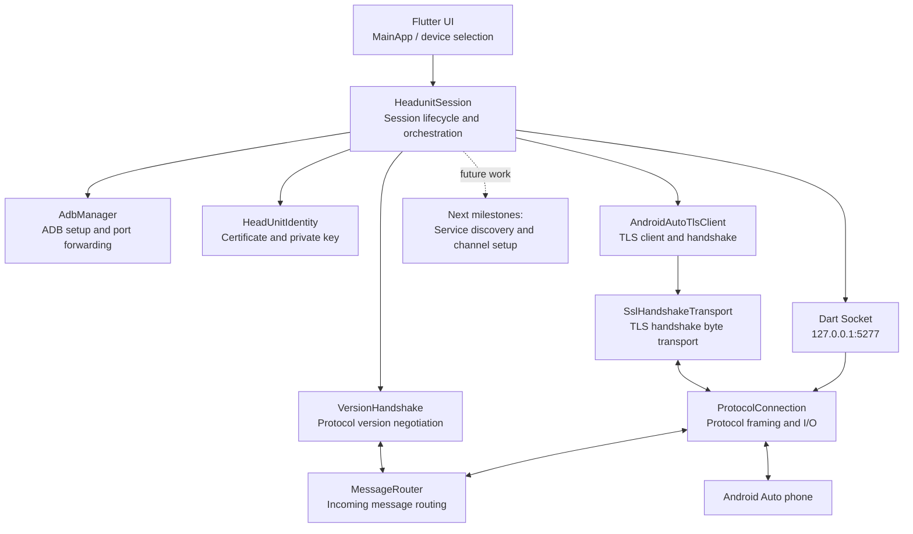
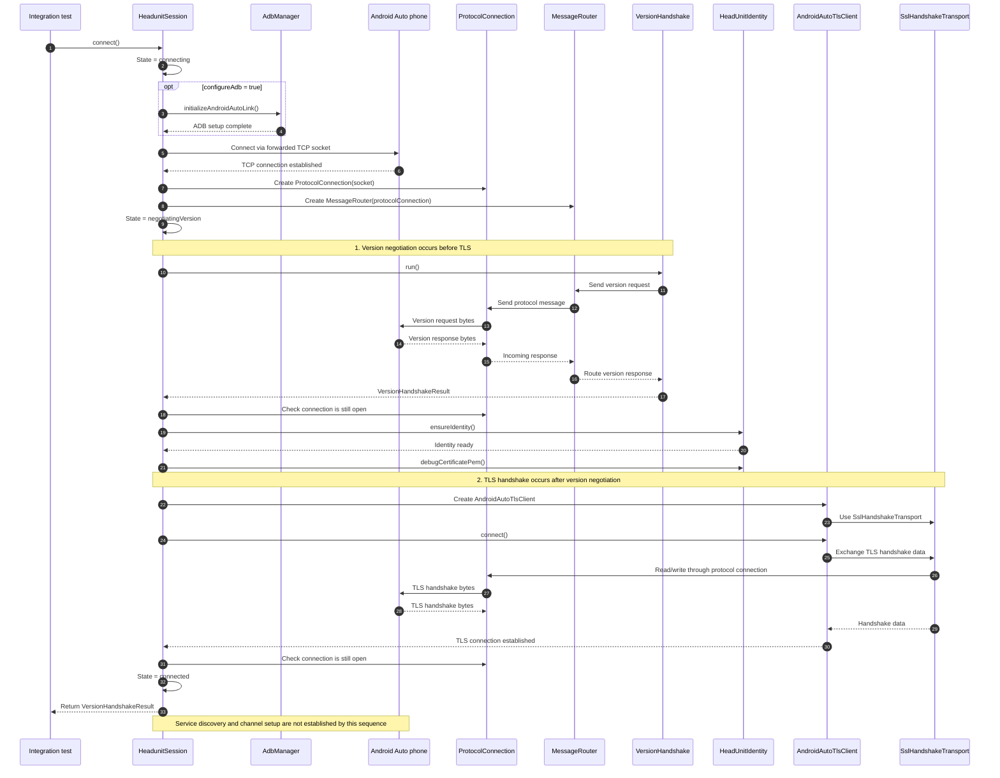
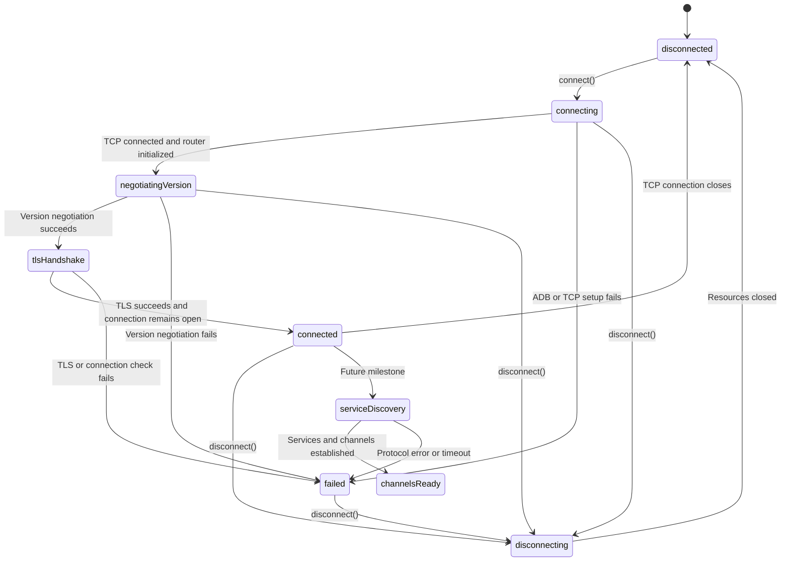

# FlutterAuto — Current Architecture

> **Status:** Architecture snapshot based on the current implementation and integration tests. This documents the known components and their responsibilities. It does **not** claim that Android Auto service discovery, channel establishment, or projection is complete.

## Scope

FlutterAuto is a Flutter/Dart Android Auto head-unit client. It connects to an Android phone through an ADB-forwarded TCP socket, initializes protocol messaging, negotiates the Android Auto protocol version, and then performs the TLS handshake. Development work is continuing toward a complete head-unit session.

## Component overview



The diagram shows conceptual class relationships. The exact behavior of the TLS transport depends on the implementations of `AndroidAutoTlsClient` and `SslHandshakeTransport`.

## Known responsibilities

| Component | Responsibility |
| --- | --- |
| `MainApp` / Flutter UI | Provides the application interface and device-selection workflow. |
| `AdbManager` | Initializes the ADB-based link and configures the port forwarding used by the app. |
| `HeadunitSession` | Orchestrates connection setup, version negotiation, TLS setup, session state transitions, and resource cleanup. |
| `HeadUnitIdentity` | Ensures the head-unit certificate and private key are available for TLS setup. |
| `ProtocolConnection` | Sends and receives protocol data over the TCP socket and provides protocol framing and I/O. |
| `MessageRouter` | Routes incoming protocol messages to the appropriate handler. |
| `VersionHandshake` | Exchanges version-negotiation messages through the message router and returns a `VersionHandshakeResult`. |
| `AndroidAutoTlsClient` | Coordinates the TLS client connection and handshake. |
| `SslHandshakeTransport` | Bridges TLS handshake data to and from the existing protocol connection. |

## Connection and handshake sequence

The order below follows the supplied `HeadunitSession.connect()` implementation.



### Simplified state machine



> `tlsHandshake`, `serviceDiscovery`, and `channelsReady` in this diagram are conceptual labels. The current `HeadunitSessionState` enum contains `disconnected`, `connecting`, `negotiatingVersion`, `connected`, `disconnecting`, and `failed`. It does not currently contain a dedicated TLS or service-discovery state.

## Current verified progress

Development logs previously reported:

```text
[TLS] SSL_do_handshake result=1, error=0
[TLS] Handshake completed successfully.
Version negotiation succeeded: Instance of 'VersionHandshakeResult'
```

This indicates that TLS completed successfully and version negotiation returned successfully in the reported run. The supplied `HeadunitSession.connect()` code confirms that version negotiation runs before TLS.

The integration tests include:

- A version-negotiation test that checks `result.majorVersion > 0` and `result.status.value == 0`.
- A head-unit session test that calls `session.connect()` and checks `session.isConnected`.

These checks do not independently prove that service discovery, channel establishment, media, navigation, or projection works.

## Suggested next architecture milestones

1. **Control-message handling:** Handle protocol control messages after version negotiation and TLS setup as required by the reference implementation.
2. **Service discovery:** Implement service-discovery requests, responses, and payload parsing.
3. **Channel lifecycle:** Implement channel creation, opening, closing, and lifecycle management.
4. **Service-specific handlers:** Add payload parsing and dispatch for individual Android Auto services.
5. **Session robustness:** Improve timeout handling, connection-loss recovery, reconnect behavior, and state transitions.
6. **Integration testing:** Test each protocol transition against a real device and compare framing, message types, identifiers, and payloads with the C++ reference.

Keep the implementation aligned with the reference protocol and verify each milestone independently before documenting it as complete.

## Failure boundaries to test

| Stage | Useful failure tests |
| --- | --- |
| ADB setup | ADB missing, device unauthorized, forwarding command failure |
| TCP connection | Port not forwarded, connection refused, connection timeout |
| Version negotiation | Unexpected message, nonzero status, unsupported version, timeout |
| Identity preparation | Missing certificate, missing private key, invalid identity |
| TLS handshake | Peer closes connection, malformed TLS data, handshake timeout |
| Session cleanup | Disconnect during setup, repeated disconnect, disposal after failure |
| Future service discovery | Unknown service, malformed payload, channel-open rejection, phone disconnect |

## Operational notes

- Keep protocol packet and byte dumps at `fine` log level.
- Include the current stage, error details, and stack trace in failure logs.
- Close the TLS client, message router, protocol connection, and underlying socket according to their ownership rules.
- Ensure the state exposed by `isConnected` accurately reflects the intended meaning of a connected session.
- Treat the certificate/private-key pair copied from the public C++ reference as development-only. Do not bundle that identity in a production APK: Flutter assets can be extracted from the built application.
